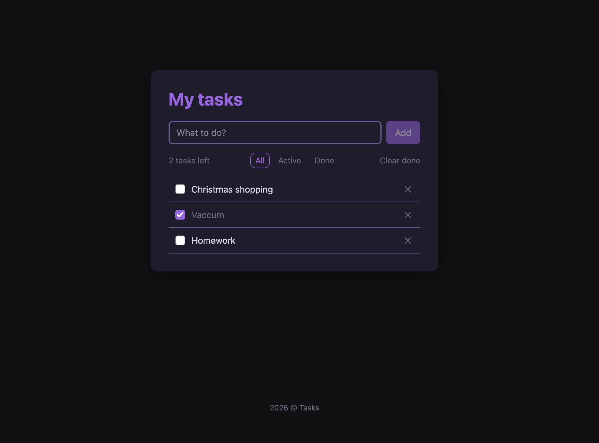

# Tasks

[](https://github.com/linasvard/tasks/actions/workflows/deploy.yml)
[](https://linasvard.github.io/tasks/)


A small to-do app built with Vue 3 and Vite while learning Vue. Add, edit, check
off and filter tasks. Everything is saved in the browser, so your list is still
there after a reload.

**🔗 Live demo:** https://linasvard.github.io/tasks/



## Feautures

- Add, check off and delete tasks
- Double-click a task to edit (Enter saves, Esc cancels)
- Filter by all, active or done tasks, with a counter of tasks left
- Clear all done tasks at once
- Dark theme and responsive layout
- Automatic deployment on Github Pages with GitHub Actions

## What I practiced

- Reactivity with `ref`, `computed` and `watch`
- Template syntax: `v-model`, `v-for`, `v-if`, event and attribute bindings
- Splitting the UI into components with `props`, `emits` and `defineModel`
- Moving logic into reusable composable (`useTodos`)

## Run locally

Requires Node.js 20.19 or newer.

```bash
cd learning-vue
npm install
npm run dev
```

Then open the server address in the browser, usually `http://localhost:5173`.

## Built with

[Vue 3](https://vuejs.org) · [Vite](https://vite.dev) · GitHub Actions · GitHub
Pages
